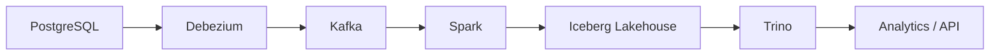

# Zakariae Elghouali

**Computer Engineering Student · Data Engineering · Cloud & Distributed Systems · Applied AI**

ENSET Mohammedia, Morocco | Open to **PFE 2027 internships in Data Engineering and Cloud Engineering**

I study Big Data & Cloud Computing and build projects at the intersection of **data platforms, distributed software and AI**. I am particularly interested in turning raw operational data into reliable, useful datasets and services — from ingestion and transformation to analytics and deployment.

## Featured engineering projects

| Project | What it demonstrates |
| --- | --- |
| **[CDC Medallion Lakehouse](https://github.com/Elghouali/cdc-pipeline-bigdata)** | End-to-end reference architecture: PostgreSQL change data capture, Debezium, Kafka, Spark Structured Streaming, Iceberg Bronze/Silver/Gold tables, Trino and analytics APIs. |
| **[KODYRA FleetOps](https://github.com/Elghouali/kodyra-fleetops)** | Rental operations demo with booking validation, fleet analytics and an offline Python/SQLite ETL pipeline, data-quality checks, dimensional modeling and CSV exports. |
| **[Local LLM Chatbot & Benchmark](https://github.com/Elghouali/ENSET-Chatbot-LLM-Comparison)** | Ollama and Streamlit application for comparing local models, measuring latency, throughput and resource usage, and exporting benchmark results. |
| **[Kafka Event-Driven Architecture](https://github.com/Elghouali/TP3-Kafka-Event-Driven-Architecture)** | Event producers and consumers, stream aggregation and Spring Cloud Stream. |
| **[Spring Cloud & Agentic AI E-Banking](https://github.com/Elghouali/Projet-Synthese-SpringCloud-AgenticAI-EBank)** | Distributed banking case study with service discovery, API gateway, resilience and a read-only Spring AI/MCP assistant. |
| **[AgriTrace](https://github.com/Elghouali/AgriTrace)** | Agricultural traceability prototype using FastAPI, React, PostgreSQL and QR codes. |

These repositories include academic projects, reference implementations and product prototypes. See individual READMEs for setup, tests and known limitations; they are not claims of production deployments.

### Data engineering architecture in focus

Explore the [CDC pipeline repository](https://github.com/Elghouali/cdc-pipeline-bigdata) for the detailed architecture, medallion layers and local infrastructure.

## What I'm building now

- **[Engineering Apprenticeship](https://github.com/Elghouali/engineering-apprenticeship)** — a GitHub-native learning initiative centered on realistic engineering tasks, hands-on labs and end-to-end projects in Big Data and Cloud Computing. In development.
- **[ENSET Advanced RAG Chatbot](https://github.com/Elghouali/ENSET-Advanced-RAG-Chatbot)** — a new academic project exploring retrieval-augmented generation. Early-stage repository.
- **[KODYRA](https://github.com/Elghouali/kodyra-website)** — an early-stage software development initiative focused on practical business problems, with FleetOps as a demonstration project.

## Technical toolkit

| Domain | Technologies & concepts |
| --- | --- |
| **Programming & databases** | Python, SQL, Java, PostgreSQL, SQLite |
| **Data engineering** | Apache Kafka, Debezium, Spark / PySpark, Apache Iceberg, Trino, CDC, ETL/ELT, data modeling |
| **Cloud & DevOps** | Linux, Docker, Docker Compose, Git, GitHub Actions, Jenkins, CI/CD |
| **Software & distributed systems** | FastAPI, Spring Boot, Spring Cloud, REST APIs, microservices |
| **AI engineering** | Ollama, Streamlit, LLM evaluation, Spring AI, MCP |
| **Currently expanding** | Airflow, cloud architecture (AWS / GCP / Azure), RAG, MLOps |

My toolkit combines hands-on project experience with technologies I am actively learning.

## Education & certifications

- **ENSET Mohammedia** — Computer Engineering, Big Data & Cloud Computing
- **CPGE** — Two years of preparatory studies in mathematics, physics and problem-solving
- **Cisco certifications** — CCNA, Python Essentials 1 & 2, C Essentials

## Engineering principles

Design before implementation. Build incrementally. Make data quality and reliability explicit. Use version control, document trade-offs, and verify results with tests rather than assumptions.

## Let's connect

I am interested in internship opportunities, open-source collaboration and real-world projects involving data platforms, streaming, cloud infrastructure and applied AI.

[LinkedIn](https://ma.linkedin.com/in/zakariae-elghouali-44170b280) · [Portfolio](https://portfolio-elghoualis-projects.vercel.app) · [Email](mailto:elghoualizakariae@gmail.com)
